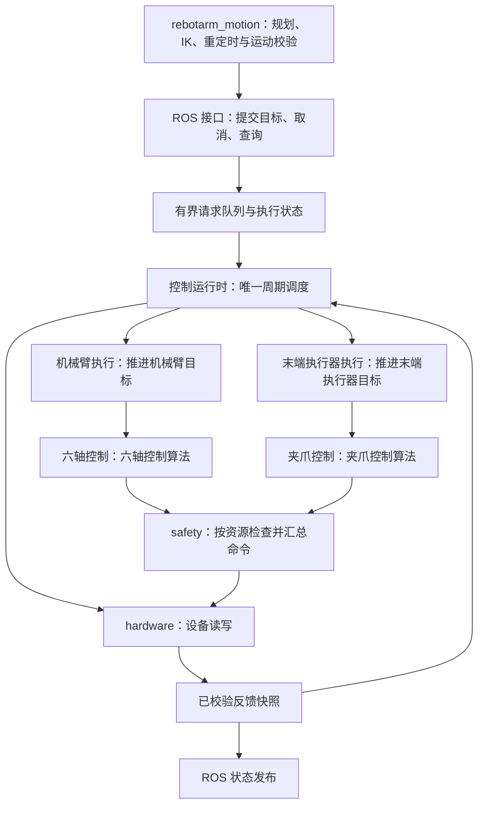

# 硬件控制器功能拆分与 C++ 迁移初步规划

> 状态：DESIGN；类型：控制器拆分与 SDK 功能整合方案，按批次实施，当前进展见项目状态；适用范围：Ubuntu 24.04 / ROS 2 Jazzy 的 `rebotarmcontroller` 与其 SDK 依赖；最后核对：2026-10-27（收口过渡依赖，明确驱动及位姿接口行为变化，合并批次与验收门）。

## 当前范围

目标是把电机驱动、周期运行时、执行保护、控制算法、执行流程和 ROS 接口分开，随后把周期控制链迁移到 C++。最底层只负责设备访问，上层通过明确接口使用它。

六轴与夹爪分别拥有控制算法和执行状态，共用运行时与唯一总线入口。本文的文件与组件归属用于 `hardware_manager.py` 的 Python 解耦和后续 C++ 迁移；项目进展、确认记录与既有实机结论以 [project_status.md](../reference/project_status.md) 为准。

将 `third_party/reBotArm_control_py` 中当前依赖的功能按职责归入控制器与运动包，不另建完整 SDK；未使用部分不迁入。完成后生产路径应摆脱该 SDK 仓库的运行时依赖，MotorBridge 与 Pinocchio 仍作为底层依赖。

## 前置条件与当前依据

2026-10-27 当前工作区源码核对：

- `hardware_manager.py` 共 3096 行，`HardwareManager` 有 132 个方法，集中了设备连接、反馈缓存、生命周期、位置保持、回位、重力补偿、夹爪与线程管理。
- `ros_actions.py` 共 672 行，除 ROS Action 协议处理外，还负责轨迹时间推进、到位等待和取消；会直接修改 SDK 的 `_q_target` 等内部成员。
- `ros_services.py` 通过 SDK 执行 IK，硬件管理器通过 `ArmEndPos` 持有模型和控制状态；运动学与电机驱动尚未完全分开。
- 周期控制共用一个 SDK 控制线程，但生命周期操作及低层透传仍可在调用线程直接访问电机；总线互斥通过包装 SDK 方法实现。已有总线锁不等于所有设备操作都已由同一个线程调度。
- `grasp_gripper()` 的堵转判定在阻塞等待循环内，`_gripper_tick()` 则负责周期发送；拆分夹爪时需要一并明确这两处状态的归属。
- 统一反馈可用性判定、查询只读、原始故障码保留及 0～90 mm 命令范围作为当前基线；历史验证范围见项目状态，行为规则见硬件执行说明。
- SDK 仍有运动层使用者 `pose_preview_solver.py`。只替换硬件包的导入，不足以删除整个 SDK 依赖。
- 当前 MotorBridge 补丁包含 C ABI 的反馈序号接口及 Rust 实现；安装库的只读动态加载初探已确认版本、能力标志及所需符号。句柄操作、协议时序及释放仍需验证，详见 [ABI 前置核对](#motorbridge-abi-前置核对)。

依据：[当前架构](../implemented/architecture.md)、[硬件包说明](../../src/rebotarmcontroller/README.md)、[硬件执行说明](../implemented/features/hardware_execution.md)、[MotorBridge 补丁](../../patches/motorbridge/0001-add-feedback-sequence-api.patch)。行数仅作为本次设计依据，不作为重构验收指标。

工作区已有未提交的文档与源码修改；实施前记录差异并固定基线，保留原有修改。严格只读连接仍是 [问题记录](../../problem/问题记录.md) 中的待处理项；当前反馈状态修复不代表该模式已经实现。

## 目标架构

### 先拆模块，保留一个硬件包

保留包名 `rebotarmcontroller` 和唯一硬件进程，在包内按文件建立职责边界。后续控制器拆分直接使用包根目录下的模块，不再按职责创建子目录；组件职责、接口与独立状态仍须保持清晰。

| 建议模块 | 拥有的职责和状态 | 边界 |
| --- | --- | --- |
| 值契约模块 | 反馈、命令、故障、执行结果的数据类型与接口 | 不依赖 ROS 消息或 SDK 对象 |
| 设备驱动模块 | 总线连接、设备句柄、电机注册、反馈解码、模式与指令收发 | 不知道轨迹、抓取目标、回位目标和重力补偿策略 |
| 运行时模块 | 唯一总线所有者、周期调度、命令仲裁、反馈快照、控制模式交接 | ROS 回调不能直接操作设备；失能时也能按既定策略采集反馈 |
| 安全检查模块 | 反馈有效性、最终指令约束、生命周期准入、故障分类及执行保护决策 | 不负责路径规划与碰撞搜索；运动层保留自己的轨迹及运行时检查 |
| 六轴控制模块 | 六轴关节位置跟踪、位置保持、重力补偿及各算法内部状态 | 输入六轴反馈与机械臂目标，输出六轴命令；不管理夹爪目标和接触状态 |
| 夹爪控制模块 | 夹爪开口控制、接触判定、夹持保持、释放及其独立状态 | 输入夹爪反馈与目标，输出夹爪命令；不读写六轴算法内部状态 |
| 执行模块 | 按机械臂与末端执行器分开管理目标、资源占用、取消/抢占、超时和到位；机械臂分支承担轨迹与回位执行 | 执行已校验目标，不生成笛卡尔路径或重新做 IK |
| ROS 适配模块 | Topic、Service、Action、参数、消息转换、反馈发布 | 提交请求与读取快照，不操作 SDK 私有成员，不用回调睡眠推进周期控制 |
| 节点装配入口 | 创建组件、注入依赖、启动与关闭协调 | 不积累控制算法和业务判断 |

`hardware_manager.py` 过渡期作为兼容入口转发现有调用；组件应持有各自状态，不能通过“把 manager 传给每个组件”继续共享全部内部变量。调用方迁移完后删除兼容层，或将其收敛为无控制细节的装配对象。

### 六轴机械臂与末端执行器分别控制

机械臂和夹爪分别使用根目录中的控制与执行模块；位置、保持和重力补偿按职责分工，不依靠目录区分状态。

- **数据分别定义**：机械臂状态、目标与控制输出只包含六轴；夹爪拥有独立的开口、运动状态、接触判定和命令结果，不作为“第七轴”拼入六轴控制向量。设备层可以按电机标识统一编解码，控制层必须按资源类型分发。
- **参数分别维护**：六轴增益、关节限位、重力模型与夹爪开口映射、限力参数、接触阈值、保持时限分开配置。夹爪电机力矩与指端夹持力分开表达，未标定时不能把两者等同。
- **状态机分别持有**：机械臂控制模式与轨迹执行状态独立于夹爪位置/抓取/保持/释放状态。取消机械臂轨迹是否影响夹持、取消夹爪目标是否影响机械臂，应由明确的执行协调策略决定，不能靠共享一个 `_running` 或全局模式变量联动。
- **统一调度与写入**：两个控制分支均不直接访问设备；运行时分发反馈、调用各自控制算法，经统一保护检查后，按资源标识汇总命令并串行访问同一总线。独立算法不要求独立进程、串口会话或通信线程。
- **保护范围明确**：分别记录机械臂、末端执行器和总线故障；单设备故障是否影响整机，依据共享总线、持物状态和已验证保护策略决定。算法分离既不意味着故障一律互不影响，也不能将普通任务取消统一处理为整机失能。
- **保留物理耦合**：末端执行器作为负载，其质量、质心和已验证的持物负载仍影响六轴重力补偿与模型；控制算法分离不等于删除模型中的末端负载。

后续替换其他末端工具时，提供对应控制模块和设备适配，避免修改六轴控制算法；首轮只实现现有夹爪，不预先构建通用插件框架。

### 依赖和数据流



反馈检查在控制算法使用数据前完成；图中的 `safety` 还承担最终写入检查。状态快照只表示软件一致读取的一批数据，不宣称所有电机同时采样；保留每台电机自己的序号和时间戳。

### 跨包职责

- `rebotarm_motion`：保留 IK、轨迹生成、重定时、碰撞检查与运动运行时校验。当前硬件服务中的 IK/笛卡尔轨迹生成迁入该层；保留 ROS 名称和消息类型，结果含义按下文行为表明确调整，避免控制包与运动包循环依赖。
- `rebotarmcontroller`：保留轨迹执行、位置保持、重力补偿、夹爪控制及最后一道设备保护。它们拆出驱动，但仍属于本地执行链。
- `rebotarm_moveit_config`：继续提供规范 URDF、模型资源和规划配置；控制器可以读取模型资源，不反向调用运动规划实现。
- FK/动力学：优先复用 Pinocchio，在使用方保留薄适配；只有实际存在稳定共享接口时才设纯数学库，不为迁移预先增加通用包。
- `rebotarm_bringup`：负责选择 Python 或 C++ 后端，同一时间只能有一个真实总线所有者和一个对应 Action 服务端。

已接纳轨迹的时间采样属于执行；路径生成与速度规划属于运动。第一轮保持当前轨迹执行语义，改进插值算法需另列行为变更并验证。

## 核心接口草案

以下类型为语义草案，不是已存在的 API；Python 拆分和 C++ 实现应遵循同一份契约。

| 接口/类型 | 关键内容 |
| --- | --- |
| `MotorState` / `FeedbackSnapshot` | 设备标识、位置/速度/力矩、状态码、每电机序号、单调时钟接收时间、有效性；关节单位为 rad，夹爪开口的 m 映射在上层完成 |
| `MotorCommand` / `CommandBatch` | 目标资源、模式、位置/速度/力矩或 MIT 参数、命令编号、所属任务/模式代次、有效期、应用结果 |
| `MotorDriver` | 按 C ABI 的控制器/电机句柄操作设计连接、采集、写入、模式、使能与释放；驱动内部拥有句柄，业务层只见值类型和回执；失败不吞异常，不暗中回位或停止运行时线程 |
| `ArmState` / `ArmTarget` / `ArmCommand` | 六轴反馈、目标和输出；不包含夹爪开口、接触状态与夹爪电机参数 |
| `GripperState` / `GripperTarget` / `GripperCommand` | 独立的开口、反馈时效、接触判定与目标语义；区分开口控制、抓取、保持和释放，单位及电机映射由夹爪分支定义 |
| `ArmControlLaw.update` / `GripperControlLaw.update` | 使用各自强类型的状态与目标，返回各自控制输出及诊断；不自行通信、发布 ROS 消息或启动线程 |
| `ArmExecution` / `EndEffectorExecution` | 各自提供 `submit/cancel/status`，管理本资源的目标准入、进度和终态；协同动作通过明确协调接口组合 |
| `SafetyDecision` | 允许、拒绝、受控停止保持、保护性失能及原因；禁止用一个通用异常处理覆盖全部情况 |

需要在第一轮明确的约束：

1. **状态归属**：设备生命周期归运行时；机械臂与末端任务状态分别归各自执行器；六轴积分状态归机械臂算法，夹爪接触与保持状态归夹爪算法；ROS goal 只映射对应资源的执行结果。
2. **资源与优先级**：机械臂轨迹和机械臂透传互斥，夹爪位置/抓取/透传也在夹爪资源内互斥；两类资源是否并行按声明协调，不能把所有目标粗暴合成全局单目标，也不能产生第二个总线线程。
3. **取消与抢占**：新目标或模式交接后，旧代次命令必须被拒绝；取消终态与实际停止/保持的确认条件写清楚，防止旧回调再次写入。
4. **时钟与缓存**：控制时序和超时使用单调时钟，ROS 时间只作消息表达；重复发布缓存不能被当作新反馈。
5. **部分发送失败**：多电机批次不是总线事务意义上的原子操作，需记录哪些指令已经发送，并进入对应保护分支，不能简单重试整批或返回成功。
6. **最终保护在本地**：上层进程退出、请求队列堵塞或目标过期时，本地运行时仍能按已定义策略处理。健康设备的可恢复任务失败不得直接失能。

`read → validate → update target → compute → guard → write` 表示逻辑顺序。实际反馈刷新应遵守独立频率和通信预算，不要求每个控制周期都进行完整阻塞轮询。

## SDK 已用功能的本地整合方案

### 核对范围与依赖入口

2026-10-27 核对本机 SDK 为固定提交 `6a49302804f25e624995e771acb6d61896d1856d`，其工作区无未提交修改。以当前生产调用及其内部依赖为迁移依据，不以 SDK 的包级导出列表作为功能需求。

- [hardware_manager.py](../../src/rebotarmcontroller/rebotarmcontroller/hardware_manager.py)：直接导入 `RobotArm`、`ArmEndPos`、`compute_fk` 和夹爪配置 `load_cfg`；默认机械臂及夹爪配置也从 SDK 目录读取。
- [ros_services.py](../../src/rebotarmcontroller/rebotarmcontroller/ros_services.py)、[ros_actions.py](../../src/rebotarmcontroller/rebotarmcontroller/ros_actions.py) 与 [motor_passthrough.py](../../src/rebotarmcontroller/rebotarmcontroller/motor_passthrough.py)：间接使用 `ArmEndPos` 的 IK、笛卡尔轨迹、目标缓存和送点线程，并访问其私有状态。
- [pose_preview_solver.py](../../src/rebotarm_motion/rebotarm_motion/pose_preview_solver.py)：使用 SDK 的模型加载、末端帧定位、位姿转换、带重试 IK 与 FK；这是移除 SDK 运行依赖必须一并迁移的纯计算使用者。
- `tests/test_hardware_manager_p0_safety.py` 仍导入 SDK 夹爪配置加载器；安装说明和接口手册也有 SDK 路径及导入要求，需要随实现完成同步更新。独立 Star Arm 跟随工具直接使用 MotorBridge，不属于此 Python SDK 的迁移范围。

### 功能迁入清单

下表目标文件均为拟议路径，路径相对于各包的 Python 模块目录；包级 `config/` 另行注明。现有本地反馈、安全与重力实现优先保留，SDK 的相同能力由这些组件接管，避免产生第二份实现。

| SDK 来源与实际使用能力 | 迁入位置与组件 | 迁移要求 |
| --- | --- | --- |
| `actuator/arm.py` 的 `JointCfg/load_cfg`；`actuator/gripper.py` 的 `GripperCfg/load_cfg` | `rebotarmcontroller/configuration.py` | 保留数值、单位、六轴顺序及显式覆盖；仅接纳 damiao；内存覆盖 channel，校验夹爪共享通道；解析不导入 MotorBridge、不打开设备 |
| SDK `config/arm.yaml`、`config/gripper.yaml` | `src/rebotarmcontroller/config/arm.yaml`、`gripper.yaml` | 纳入本包安装资源；默认路径从 SDK 目录改为本包 share，保留显式 YAML 路径和 channel 覆盖；迁入时核对数值，不同时调参 |
| `RobotArm` 的控制器创建、设备注册、句柄及总线映射 | `rebotarmcontroller/sdk_driver.py` → `SdkMotorDriver` | 仅适配 damiao；直接使用带序号补丁的 MotorBridge，按物理 channel 管理唯一控制器；夹爪共享句柄所有者；不包装 `RobotArm` 或模仿其私有成员 |
| `RobotArm` 的反馈请求/轮询、状态与 MIT/POS_VEL/VEL 设备操作 | 驱动提供原始操作；`feedback_acquisition.py`、`feedback_store.py` 接管采集和缓存；`feedback_safety.py` 接管可用性 | 保留本地序号验证、首帧、年龄、原因分类与新帧恢复；不迁入缺样本补零、吞掉发送异常等宽松语义 |
| `RobotArm` 的模式、寄存器、使能/失能、置零及关闭 | 底层操作归 `sdk_driver.py`；流程与确认归 `lifecycle.py` | 纳入寄存器 25～28 的 POS_VEL 参数写入、模式确认、反馈验证与资源释放；逐电机返回结果，保留严格置零及使能回滚 |
| `RobotArm.start_control_loop/stop_control_loop` 与循环存活状态 | `rebotarmcontroller/controller_runtime.py` | 批次 2 与驱动一起替换最小周期线程；有界停止并确认退出，不使用 `Thread._stop()`；完整队列与仲裁在批次 6 接入 |
| `ArmEndPos._loop_cb`、位置目标和速度上限 | `rebotarmcontroller/arm_position_control.py` | 批次 2 接管最小位置输出，只生成 POS_VEL 命令，发送归驱动；不保留 SDK 控制对象或另一份公开可写目标 |
| `ArmEndPos` 的轨迹列表、送点、停止与运行状态 | `rebotarmcontroller/arm_execution.py` 与运行时 | 批次 2 接管最小目标/轨迹游标，停止 SDK 送点线程；后续补全执行器。用窄接口替代 `_q_target/_moving/_stop_send/_traj/_traj_idx`，取消后旧目标失效 |
| `ArmEndPos._home_vel/_dt/_n/_vlim_override` 及本地 `safe_home` | 静态参数归 `configuration.py`；任务覆盖归 `arm_execution.py`，位置算法消费有效上限 | 保留 0.3 rad/s 回位上限、20 ms 到位轮询与六轴维度；速度覆盖在任务结束/取消时清除，不与普通目标共享可变缓存；20 ms 不是硬件循环频率 |
| `kinematics/robot_model.py` 的模型加载/末端帧；`forward_kinematics.py` 的 FK | 控制器薄适配 `controller_kinematics.py`；运动包薄适配 `kinematics/model.py`、`forward.py` | 两处均直接调用 Pinocchio，读取同一规范 URDF，不互相导入实现或复制 IK 算法；模型与运行数据各自持有，输出普通数值 |
| `inverse_kinematics.py` 的 `pos_rot_to_se3/solve_ik/solve_ik_with_retry`、所需参数与结果类型 | `rebotarm_motion/kinematics/inverse.py`，接入现有 `pose_preview_solver.py` | 保留现用迭代、阻尼、回溯与重试策略的对照样本；测试可注入随机源；不可达不产生执行目标，求解成功仍需运动校验 |
| `trajectory/sampler.py` 的现用 SE(3) 路径采样与最小 jerk 时间剖面；`clik_tracker.py` 的 CLIK 跟踪及内部限位辅助 | `rebotarm_motion/cartesian_trajectory.py` | 承接 `ArmEndPos.move_to_traj` 的纯计算部分，保留当前 20 ms 采样参数和逐点求解结果；未使用的线性/梯形剖面不作为迁入要求；输出经校验的关节轨迹，由控制器执行，不携带硬件句柄或发送线程 |
| `ArmEndPos.move_to_ik/move_to_traj` 的入口协调 | 运动包 `pose_compat_node.py` | 保留旧服务/Action 名称与类型，经运动校验、重定时后走 FJT；明确下文成功、容差与取消语义变化；bringup 切换唯一服务端，控制器不反向导入运动实现 |

控制器的 `controller_kinematics.py` 只承载反馈位姿查询需要的薄 FK 适配；其余模型/动力学继续复用现有 `gravity_control.py`，不导入 SDK 的 `dynamics/`。运动包增加如下纯计算边界：

```text
rebotarm_motion/
├── kinematics/
│   ├── model.py                 # 规范模型、六轴降维与末端帧定位
│   ├── forward.py               # Pinocchio FK 薄适配
│   └── inverse.py               # 已使用的 IK、重试与参数/结果
├── cartesian_trajectory.py      # SE(3) 采样与 CLIK 纯计算
├── pose_preview_solver.py      # 保留上层接口，替换 SDK 导入及路径注入
├── pose_compat_node.py          # 旧位姿服务/Action 适配，经运动校验后转 FJT
└── pose_execution_node.py       # 保留现有 MoveIt 位姿执行入口
```

模型资源继续由 `rebotarm_moveit_config` 拥有。FK 两个使用方各保留少量 Pinocchio 调用适配，IK 和路径生成只归运动包；不为这次迁移增加一个通用 SDK 包，也不在配置包中加入计算业务。

### 规范模型与现有行为的处理

SDK 默认 URDF 与项目规范模型并不完全一致：SDK 的第三轴名为 `join3`，J2/J3 上限为 `0 rad`；规范 URDF 使用 `joint3`，J2/J3 上限为 `+0.02 rad`，并包含手指关节及当前末端模型。当前重力补偿已经使用规范模型，而 `ArmEndPos` 和位姿预览仍默认加载 SDK 模型。

整合直接使用正确的项目规范模型 `rebotarm_moveit_config/config/rebotarm.urdf`，保留 `joint3` 与 J2/J3 的 `+0.02 rad` 上限；SDK 的不同命名和限位仅作迁移背景，不列为项目模型缺陷或待解决问题，也不要求迁入实现复现这些差异。

构建 `joint1..joint6` 顺序的六轴模型，锁定规范手指关节，保留 `end_link` 的坐标约定；不复制 SDK 的另一套 URDF/网格。验收以规范模型为预期，验证模型资源加载、六轴映射、FK 参考值、IK 回代误差与规范限位，包括 J2/J3 上端范围。旧 SDK 输出只用于识别切换造成的可解释差异，不作为覆盖规范模型的通过标准；不借此调整 TCP、零位或实物负载参数。

`current_pose()` 目前使用 `_endpos_ctrl._model`。切到规范模型前，以同一组关节输入比较两套 FK，记录末端帧/坐标约定、位置差范数与旋转角差的最大值及 RMS，并抽查 Dashboard 等消费方。发布位姿可能改变，差值报告和消费方验证是发布切换的前置条件；不要求把规范模型改回旧数值。

SDK `ArmEndPos` 还混合了自动使能、全零回位、设备读写、求解和线程；本地仅承接当前所需功能，按已有安全约定重组。当前代码中 FK 的第三返回值为齐次矩阵，`move_to_traj(duration<=0)` 却按 `translation()` 使用它；CLIK 返回逐点 `ik_success`，上层也不能只判断列表非空。这些需作为自动时长与逐点收敛验证的独立场景，修正时记录行为变化，不照搬已有缺陷或据此宣称整条旧链路已经验证。

### 配置与协议时序基线

`configuration.py` 分开表达部署入口参数、安全参数和协议时序；保留实际入口的覆盖关系，不能用 SDK 默认值覆盖 launch 的有效值。下表记录现状，用于迁移对照，不能替代设备确认和新鲜反馈验证；时序调整另行记录并验收。

| 参数或规则 | 当前基线及迁入要求 |
| --- | --- |
| 厂商与共享连接 | 当前配置全为 `damiao`，本地驱动只支持该厂商；其他 vendor 在打开设备前报错。按物理 channel 管理唯一 Controller，禁止按 vendor 为同一串口重复开连接 |
| channel 覆盖 | 删除 `_arm_cfg_with_channel` 写固定 `/tmp/rebotarm_ros2/arm_channel_override.yaml` 的机制，解析后在内存覆盖；全局 channel 覆盖同时作用于机械臂与夹爪，再校验两者有效通道一致。无全局覆盖时，夹爪 YAML 的 channel 与机械臂不同必须报错，不能静默忽略 |
| 传输与波特率 | 保留 `/dev/tty*` → `from_dm_serial(channel, 921600)`、其他通道 → SocketCAN 的有效行为；用明确的 transport/baud 配置表达，并保留原有自动选择规则作为兼容默认，不引入未使用的 dm-device 路径 |
| 循环频率 | SDK 默认 YAML 为 500 Hz，bringup 的 `arm.yaml` 为 100 Hz；逐入口记录实际来源，不在配置迁入时偷偷统一。反馈与发布频率仍分别配置 |
| POS_VEL 速度与默认增益 | 当前 J1～J3 `vlim=5 rad/s`、J4～J6 `vlim=3 rad/s` 是实际命令上限；MIT 默认 kp/kd、寄存器 25～28 的 PI 参数一起列为受审查安全参数，保留数值及来源，校验有限性和适用范围，不能当成普通配置直接透传任意值 |
| 使能/失能确认 | SDK 默认每电机间隔 0.05 s、最多 10 轮、轮询间隔 0.1 s；核对其轮询/重发语义及本地严格确认，不把轮询次数误写成允许盲重发次数 |
| 模式切换 | POS_VEL 写完本电机寄存器组后等待 0.02 s；逐电机模式操作间隔 0.05 s；全组稳定等待 0.2 s；现用模式确认预算 1000 ms。等待不能代替模式结果确认 |
| 循环停止与断开 | 旧循环 join 预算 5 s、停循环后等待 0.05 s；disconnect 中失能后等待 0.5 s，Controller shutdown 到 close 间隔 0.1 s。新运行时保留预算并验证线程退出，禁止 `Thread._stop()`，禁止健康回位失败后沿用无条件失能 |
| 置零 | 旧 SDK 先失能后等待 0.3 s，默认最多 200 次轮询、间隔 0.05 s，逐电机置零间隔 0.1 s；当前本地严格置零、序号新帧及近零确认优先，不能用旧 SDK 的宽松结果替换 |
| 回位与维度 | `_home_vel=0.3 rad/s`、`_dt=0.02 s`，`_n` 必须为 6；本地回位到位阈值 0.02 rad、超时 30 s；`_vlim_override` 是 `ArmExecution` 的任务状态，必须在终止路径清除 |

电机名称/ID、反馈 ID、六轴顺序、共享资源和参数单位在设备打开前校验。底层补丁的串口读取超时与应用层确认预算分开核对；迁移不凭应用 sleep 推断协议正确，也不顺带修复或引入未使用的 SDK reconnect 流程。

批次 1 的本地加载器在内存中完成覆盖与校验，但旧 `RobotArm` 构造只接受 YAML 路径。仅在临时适配器中保留文件桥接：为实例生成独立临时文件、构造完成后清理，禁止继续使用固定文件名或全局替换 SDK 加载函数；批次 2 切换本地驱动时删除该桥接和旧 `_arm_cfg_with_channel`。配置解析无设备副作用，不等于过渡期的整个 manager 构造已经无副作用。

### 明确的行为变化与失败策略

以下是各对应批次要落实的设计决策；实际已完成项、软件结果与实机边界见[项目状态](../reference/project_status.md)。驱动替换不以“仅搬代码”掩盖差异；批次 2 前固定预期和故障注入样本，设备相关变化经过批次 2H 后才能作为硬件发布基线。

| 场景 | 旧路径行为 | 迁移后的决策与验证 |
| --- | --- | --- |
| 周期单次发送失败或部分发送 | `RobotArm.pos_vel/mit` 吞掉逐电机 `CallError`，可能等到反馈过期才保护 | 驱动返回成功/失败/未尝试回执；底层发送错误导致输出不可确认时，当前周期停止后续普通命令，作废任务代次，进入通信/输出故障保护分支，对共享 Controller 去重失能；不在下一周期盲重发或自动使能。失能失败保留失败/未知状态，不报告已失能 |
| 写入前命令校验失败 | 不同入口规则不一致 | 无设备写入且硬件健康时拒绝请求并停止/保持，按资源策略处理；不能将普通参数错误当成通信故障而失能 |
| POS_VEL 寄存器写入失败 | 仅打印，仍继续模式切换 | 终止当前切换/使能流程，报告具体寄存器和电机；依据已执行步骤、反馈和生命周期状态确认或回滚，不缓存成功模式；可能使原本“能使能”的调用返回失败 |
| 打开连接的时机 | 当前 manager 在构造中创建 `RobotArm` 并开 Controller，SDK `connect()` 为空；以实际调用为准 | 本地构造只解析配置，`connect()` 才打开；打开失败在 connect/启动结果中报告，启动仍默认失能；检查调用方异常处理及 ROS 状态 |
| disable 与线程退出 | SDK disable 先 join 控制线程 | 驱动 disable 仅做设备操作，线程停止由运行时协调；周期内保护不得 self-join。保护立即禁止普通写入，退出/释放在受控路径确认 |
| `current_pose()` | 读取 SDK 模型 FK | 使用规范模型；切换前记录 FK 差值并验证消费方，不承诺发布数值完全相同 |
| `move_to_pose_ik` | IK 成功后直接改目标，速度主要受 POS_VEL vlim 限制，无轨迹 | 采用新鲜当前位置和 IK 终点构成至少两点关节轨迹，经 motion 校验和现有重定时后走 FJT，末端关节速度为零；不新增绕过 FJT 的单点设备接口，执行时序与耗时有意改变 |
| `MoveToPose` Action | SDK 送点完成后成功，不检查起点与最终收敛 | 路径生成后经运动校验/重定时转 FJT；遵守现有 0.10 rad 起点与 0.03 rad 终点容差，等待执行结果后映射终态，旧调用可能因此失败；取消必须等停止/保持确认，不以送完点判成功 |

`move_to_pose_ik` 保留原 Service 名称与消息类型：`success=true` 表示校验通过且 FJT 已接纳，响应文字明确“已接纳”，不表示已经到位；到位/失败由执行状态与诊断呈现，需要完成结果的调用方使用 Action。接纳前取消、队列超时或状态变更必须阻止后续迟到发送。两类位姿入口均不得自动使能，不放宽 FJT 容差来维持旧“成功率”；IK/CLIK 收敛不代替路径碰撞检查，碰撞结果未知或校验失败时拒绝执行。

### MotorBridge ABI 前置核对

ABI 探测是批次 0～1 的必做项，用来确定 Python `SdkMotorDriver` 的句柄操作边界与 C++ 对应关系。依据固定版本 [MotorBridge 头文件](https://github.com/motorbridge/motorbridge/blob/2b7b350914ace47ba06e85fcad333143de2b057b/motor_abi/include/motor_abi.h) 和本仓[反馈序号补丁](../../patches/motorbridge/0001-add-feedback-sequence-api.patch)，不能仅使用未含扩展的原版头文件。

- 核对 `MotorController`/`MotorHandle` 的创建、归属、释放顺序、重连后失效规则，以及 ABI 返回码与 thread-local 错误文本；错误文本及时复制，不能跨后续 ABI 调用引用。
- 核对 `MotorState` 的布局、字段类型/单位、序号 `uint64_t`、模式枚举，以及带序号接口 `motor_handle_get_state_with_sequence`；业务值类型不暴露裸句柄。
- 覆盖串口/SocketCAN 创建、damiao 注册、轮询与请求反馈、带序号读取、POS_VEL/MIT/VEL、模式/寄存器/置零、使能/失能、shutdown/close/free；用假设备或 PTY 检查超时、错误、序号和释放，不连接真实串口。
- 核对安装包与目标动态库、补丁头、capabilities 和部署搜索路径；缺口必须有明确接口映射或补充方案，才能固定批次 2 的设备适配。纯配置和离线计算工作可继续。

本机 Python 包为 `0.4.7+rebotarm.1`；只读 C++ `dlopen/dlsym` 初探得到 ABI `0.4.7`、capabilities schema `1`、`feedback_sequence=true`，21 个所需符号存在。仅调用版本/能力查询，未创建设备或电机句柄；布局、真实操作及完整 C++ 驱动仍未验证，结果见项目状态。

已安装 `motorbridge/core.py` 中 `from_dm_serial()` 不调用 `ensure_dm_device_runtime()`；后者由 `from_dm_device()` 调用，用于查找 dm-device 动态库、设置路径并在明确选项下下载。ABI 加载也可配置随包库路径，但这不是串口握手。当前串口路线不把 dm-device 初始化/下载列为必需依赖；C++ 应按所用 transport 核对真正需要的初始化。

### 不迁入的部分与保留的依赖

- `actuator/gripper.py` 的独立 `Gripper` 类及其线程：本地仅用其配置加载器；夹爪控制、限力、保持和中性释放已在本地实现，按原组件归属提取。
- SDK `dynamics/` 全目录：当前生产重力补偿直接使用本地 `gravity_control.py` 和 Pinocchio，未发现对 SDK 动力学函数的调用。
- `trajectory/trajectory_planner.py` 的通用规划包装和轨迹统计：虽被包初始化导入，当前生产调用未使用其能力；只迁入采样器和 CLIK 的实际依赖闭包。
- SDK 示例、绘图、工作空间扫描、Meshcat 可视化、ROS 1 资源、额外工具及整套 URDF/网格不迁入；它们引入的展示依赖也不随迁移加入运行环境。
- MotorBridge 的协议、反馈序号补丁及 Pinocchio 数学库继续保留；本次整合消除的是中间 Python SDK 依赖，不重写协议层或数学库。
- 保留 `third_party/reBotArm_control_py` 原目录作为来源参考，未用内容不处理。复制代码前核实来源提交、适用许可文本和版权归属，记录迁入范围与修改并保留归属头；不能用主工程许可覆盖。固定 SDK 树未发现 LICENSE/COPYING/NOTICE，pyproject 无 license 字段，只有 README 的 MIT 声明；本次上游许可文件核查未取得文本（请求返回 404），尚不能标为许可核对完成。无法核实时先推进接口设计或独立实现窄适配，不直接复制许可信息未明确的源码。

### SDK 运行依赖退出条件

迁入工作和 C++ 步骤统一使用下文[批次表](#分批交付与完成条件)。批次 2 后不再构造 `RobotArm/ArmEndPos` 或使用其控制/送点线程；尚未迁入的纯数学函数可经过渡适配调用，但不能持有设备对象。

最终在不将 SDK 目录加入 `PYTHONPATH`、且以导入阻断验证无隐式回退的隔离进程中，检查配置、FK/IK、轨迹计算、假驱动控制器和 ROS 兼容接口；安装区同样验证。更新依赖/部署文档与测试夹具，源码不再注入 SDK 路径；不删除、改名本机参考目录来实现隔离测试。

最终完成条件是控制器和运动包均不再导入 `reBotArm_control_py`、不读取 SDK 配置/模型、不使用其线程或私有状态。只有配置搬入或驱动外包一层不算完成。SDK 不可导入的测试使用拦截或隔离环境，不删除、改名本机依赖目录。

## HardwareManager 的 Python 拆分实施方案

目标是形成可独立验证、可由 C++ 实现替换的组件；保留 `rebotarmcontroller` 包名、既有 ROS 名称与一个硬件进程。先集中旧依赖，再将设备适配与最小周期调度一起替换；完整运行时仲裁后续接入。

### 文件与组件归属

下面按包根目录的文件列出组件归属。已存在和拟议模块一起列出；后续按职责增加文件，不建立控制器内部职责子目录。

```text
rebotarmcontroller/
├── hardware_manager.py        # 现有 API 的兼容门面
├── configuration.py           # 参数、范围与资源路径
├── controller_contracts.py    # 值类型、请求、结果与故障
├── legacy_backend.py          # 临时 SDK 纯计算桥，批次 6 删除
├── sdk_driver.py              # MotorBridge 设备与总线收发
├── controller_kinematics.py   # 规范模型的 FK 薄适配
├── controller_runtime.py      # 调度及后续请求仲裁
├── feedback_acquisition.py    # 拟议：反馈请求与采集调度
├── feedback_store.py          # 拟议：反馈缓存与采集错误
├── lifecycle.py               # 拟议：连接、使能与模式状态
├── feedback_safety.py         # 拟议：反馈可用性检查
├── command_guard.py           # 拟议：命令准入与保护决策
├── arm_position_control.py    # 六轴位置命令
├── arm_gravity_control.py     # 拟议：重力补偿控制与内部状态
├── arm_execution.py           # 六轴目标与轨迹执行
├── gripper_control.py         # 拟议：夹爪控制算法
├── gripper_execution.py       # 拟议：夹爪执行状态
├── gravity_control.py         # 重力补偿与模型工具
├── ros_actions.py             # Action 协议映射
├── ros_services.py            # Service 适配
├── ros_publishers.py          # 状态发布
├── motor_passthrough.py       # 低层透传与仲裁入口
├── conversions.py             # 消息与核心值类型转换
└── rebotarm_controller.py     # 装配及启停协调
```

包级配置资源仍随本包安装；各组件独立持有状态，不使用 mixin 拆类，也不将完整 manager 或共享字典作为组件接口。

| 当前方法或状态 | 拆分后的所有者 | 保留在门面的能力 |
| --- | --- | --- |
| `default_*_cfg`、SDK 路径查找、`_arm_cfg_with_channel`、构造参数校验 | `configuration.py` 负责配置；默认 YAML 迁入本包，以内存覆盖替代临时文件；完成迁移后删除 SDK 路径注入 | 接受现有构造参数，保留显式路径覆盖；不顺带统一不同入口的默认值 |
| `init_gripper` 的设备注册、`_patch_*_bus*`、`_wrap_motor_bus`、实际 send/enable/disable/mode/zero 调用 | `SdkMotorDriver` | 提交设备操作；不向外返回可写的 SDK 对象 |
| `_refresh_feedback_batch`、`_force_feedback_refresh`、`_inspect_pending_feedback`、接收序号基线与 deadline | `FeedbackAcquisition`，由运行时调用驱动 | `refresh_feedback_if_due()` 过渡转发，后续发布端只取快照 |
| `_verified_feedback_by_label`、采集错误、观测时间、`get_cached_*`、`get_feedback_status` | `FeedbackStore` 持有数据；`feedback_safety.py` 提供只读判断 | 返回现有数值/状态/原因和一致快照 |
| `connect/enable/disable/set_mode/set_zero/shutdown`、回滚、生命周期字段与置零失败标志 | `LifecycleController` 持有迁移及验证状态；运行时执行设备操作 | 保留公共方法及结果语义；同步等待发生在调用侧 |
| `hold_current_position/stop_active_motion/safe_home`、速度覆盖及轨迹状态 | `ArmExecution`；回位参数和六轴维度归配置，保持输出归 `ArmPositionControl` | 委托六轴执行，停止结果以实际保持确认为准 |
| `_gravity_comp_tick`、`_gravity_comp_*`、`_gc_*` | 模型与积分/跟随状态归 `ArmGravityControl`；模式交接归生命周期；时序诊断归运行时 | 启停、目标及诊断查询 |
| `set_gripper_target/grasp_gripper/wait_gripper_target`、`_gripper_tick`、中性释放与保持 deadline | `GripperExecution` 持有模式、目标、期限、终态；`GripperControl` 持有斜坡和堵转计算状态 | 保留位置/抓取/取消/释放接口及兼容等待函数 |
| `_hardware_control_tick`、启动/停止循环、保护性失能与低层透传调度 | `ControllerRuntime`；保护条件归 `SafetyPolicy` | 提交请求并查询结果，不执行周期计算 |

`gripper` 的位置/速度/力矩以反馈快照为准。算法可保留执行一次计算所需的状态，但不另建一份对外健康状态。六轴和夹爪各自持有任务状态，生命周期的整机状态及旧 `ArmStatus.state_machine` 由明确映射生成。

### 接口先稳定，再移动实现

首轮把以下契约落实为 Python 值类型和协议，并注入单调时钟、假驱动、模型等窄依赖：

| 契约 | 必须表达的内容 |
| --- | --- |
| `FeedbackObservation` / `FeedbackSnapshot` | 从 SDK 复制出的数值、原始状态码、每电机序号与本地观测时间；不保留可变 SDK 状态对象；数组需复制或限制写入 |
| `FeedbackHealth` | 是否可用、稳定原因分类、详情；六轴按原规则汇总，夹爪独立；零位验证状态由生命周期提供 |
| `ArmTarget` / `GripperTarget` | 独立资源类型、目标编号、模式代次、接纳及到期时间；六轴维度固定为 6 |
| `ControlOutput` / `CommandBatch` | 本周期输出及诊断；算法只返回命令，不发送设备、不调用 ROS、不等待反馈 |
| `WriteReceipt` / `ExecutionResult` | 每电机写入成功/失败/未尝试，以及执行接纳、进行中、停止确认和终态；中性命令未成功发送时不能提前报告夹爪释放成功 |

保留统一反馈的现有契约：首帧前、读取/序号失败、过期、非法数值、坐标及置零失败的原因分类；新合法帧清除当前采集错误，查询不改时间和错误，原始电机故障码保留。`_VerifiedFeedbackSample` 外层冻结不等于其 SDK `state` 已成为不可变值，需在驱动边界完成数值复制。

夹爪命令继续使用 0～90 mm／−5～0 rad，闭合端反馈容差继续为等效 10 mm；反馈容差、命令范围和严格置零条件分别表达。六轴限位、模型、增益及各入口实际默认值均按基线记录。

兼容门面新增的执行接口建议为 `submit_arm_trajectory`、`cancel_arm_execution`、`arm_execution_status`、`submit_gripper_target`、`cancel_gripper_execution` 和 `snapshot`。名称是草案；现有阻塞方法可以在门面等待对应结果，内部状态由执行器推进。

### 必须一并收口的现有调用

- **批次 1 的过渡边界**：将 manager、ROS 适配和透传中的全部 `_arm._*`、`_endpos_ctrl._*` 访问收进 `legacy_backend.py`，提供设备操作、目标/轨迹接纳、停止与快照等窄接口。适配器在旧路径阶段封装旧对象，不拥有第二份反馈/任务状态；批次 2 后转给本地组件，不给新驱动伪造 `_motor_map/_ctrl_map/_joints/_rate/_running/_ctrl_thread` 等 SDK 私有结构。
- `ros_actions.py`：用执行接口替代对 `_q_target/_moving/_stop_send/_traj/_traj_idx` 的读写。轨迹时间推进、超时及停止保持由 `ArmExecution` 负责；Action 回调负责目标接纳、反馈和终态映射。
- `motor_passthrough.py`：将 reject/preempt 变成运行时的原子仲裁请求；停止旧目标并确认代次变化后才接纳透传。夹爪透传同样参与夹爪资源仲裁，不能绕过执行器继续写电机。
- `ros_publishers.py`：读取成套快照及观测时间；发布回调最终不发起总线刷新。失能期间的采集由运行时承接，连接流程仍按现有模式处理，不能将此视为严格只读连接已经实现。
- `ros_services.py` 与 `MoveToPose` Action：批次 2 后禁止实例化 `ArmEndPos`；可通过临时适配以本地规范模型与数值输入调用 SDK 的纯 IK/路径函数，再向本地执行器提交目标/轨迹。批次 6 将计算及端点迁入 motion 的 `pose_compat_node.py` 并落实上述 FJT 语义；同步调整 bringup，确保同名接口只有一个服务端，避免硬件包反向依赖运动包。
- `current_pose()`：批次 2 用本地模型适配替代 SDK 模型；切换前完成 FK 差值报告。返回纯数值位姿，ROS `Pose` 转换留在适配层。

旧 `ArmEndPos` 的送点线程、SDK 控制循环及所有设备访问都需列入迁移清单。只把 manager 中的代码搬走，仍调用这些线程或从 ROS 改 SDK 目标，不能算拆分完成。

### 分批交付与完成条件

| 批次 | Python 拆分与 SDK 迁入 | ABI / C++ 工作 | 完成条件与发布门 |
| --- | --- | --- | --- |
| 0. 固定基线 | 保存已有差异、ROS 契约、参数来源、SDK 调用、线程/锁及隐含时序；固定发送失败策略和行为变化清单，核查许可 | 动态库/补丁头/能力与符号清单，明确 transport 初始化 | 基线测试可复现；不将既有脏改动混入；许可未明确前不复制相应源码 |
| 1. 契约、配置与旧访问收口 | 提取值类型、加载器、YAML 和资源定位；内存覆盖与通道/vendor 校验，旧 SDK 文件桥接限于临时适配器；全部 SDK 私有访问收口 | 验证头与库布局、错误、句柄所有权及释放；PTY/假设备探测，确定 Python→C ABI 对应关系 | 门面仍可用；无 SDK 对象进入契约；ABI 缺口有明确解决方案；默认值/安全参数与覆盖关系不漂移；FK 对照样本就绪 |
| 2. 驱动与最小周期一起替换 | 本地 damiao 驱动 + `ControllerRuntime` 最小循环 + `ArmPositionControl` + `ArmExecution` 最小目标/轨迹游标同时接管；保留反馈/保护实现，接入本地 FK，删除配置文件桥接 | 使用批次 1 的句柄操作接口；验证严格写入、部分失败、无 self-join 与释放 | 生产不再创建 `RobotArm/ArmEndPos`、不再使用 SDK 循环/送点线程；旧线程退出后启动新循环；不模仿 SDK 私有结构；FK 差值和故障注入完成。设备发布等待 2H |
| 2H. 低层实机检查 | 另行授权后验证连接、新鲜反馈、显式使能/失能、模式切换及置零前置条件拒绝；不提交运动目标、不写新零位 | 核实真实传输、时序、失败暴露与设备状态 | 现场支撑/安全基线下分项记录；使能/模式可能有机械响应，不能称为只读或保证无运动。未执行前不宣称设备等价或发布硬件切换 |
| 3. 反馈提取 | 拆出采集、缓存及只读健康判定，替代 manager 中保留的反馈实现 | 复用带序号 ABI，冻结跨语言反馈样本 | 原因/时间戳/恢复、旧合法帧后新非法帧、序号回绕与禁止外部同步刷新测试通过 |
| 4. 夹爪提取 | 提取 `GripperExecution + GripperControl`，堵转检测改为周期输入/事件 | 固定独立夹爪输入/输出与保护对照样本 | 斜坡、总力矩、保持期限、中性释放、取消及失败结果正确；与六轴状态分开 |
| 5. 六轴与生命周期完善 | 在批次 2 的最小实现上补全保持/停靠/重力补偿及启停、模式、置零状态；清理参数和任务覆盖 | 固定六轴算法、状态迁移与时序样本 | 积分/限幅/交接、启用回滚、失能和严格置零不退化；健康任务失败保持；不重复改写位置输出 |
| 6. 完整仲裁与 ROS / SDK 退出 | 运行时统一设备请求、优先级及代次；迁出 ROS 执行循环；IK/CLIK/采样迁 motion，旧位姿端点转 FJT；删除临时适配器与 SDK 路径注入 | 核心接口冻结，复用 ABI 验证选择 C++ 承载框架 | 全部设备访问由运行时协调；服务端唯一；无 SDK 导入的源码/安装区测试及隔离 MoveIt Execute 链路通过；新旧位姿结果差异有对照 |
| 7. C++ 核心替换 | Python 拆分实现作为离线对照；ROS 名称与消息契约保留 | 实现驱动、运行时、算法与执行器，完成构建/安装、并发/释放/PTY/周期测量 | 相同输入输出和故障决策可解释；不在周期嵌 Python；只启一个真实后端，未把软件通过当成实机验收 |
| 8. 集成与收尾 | 清理过渡门面，更新架构、部署和状态；保留未用 SDK 原目录 | 单独授权后的 C++ 实机分项检查及必要运动验收，确认回退方式 | 启动、保持、取消、模式和故障行为分别验收；软件、仿真、历史实机结论与本次实机结论分开记录 |

唯一实施编号以上表为准。第一份交付覆盖批次 0～1；批次 2 的驱动和最小调度作为依赖闭合的一批交付，再经过 2H。未安排实机时可继续独立的软件提取，但后续硬件发布不能绕过 2H；5～6 引入的新设备流程也需补充对应实机回归。夹爪可作为第一块完整控制对象的迁移样板；重力补偿沿用 `gravity_control.py`，避免同时改算法。

第一份交付按上述归属限定为：

- 固定当前工作区差异、参数来源、公共接口与行为测试基线，记录待迁移的 SDK 访问和线程。
- 完成 ABI 前置探测、许可核查及全部 SDK 私有访问的临时适配收口；没有接口映射的 ABI 缺口不得留到驱动已替换后再处理。
- 在 `configuration.py` 提取现有参数及范围校验、SDK 已用配置类型和加载器、配置资源定位与路径覆盖；把 `arm.yaml/gripper.yaml` 安装到本包 share。设备装载与总线细节留待设备适配批次。
- 在 `controller_contracts.py` 定义并接入当前实际使用的反馈及错误值类型，边界只传递复制后的数值；目标、命令及执行结果随对应组件迁移时补齐。
- `hardware_manager.py` 转用这些配置与类型并维持公共入口；新增子包随现有打包规则安装。通过既有反馈、安全及参数行为回归后，再推进设备和反馈组件提取。

批次 2 起使用本地最小周期线程，不能再暂用挂在 `RobotArm` 上的 SDK 调度。批次 2～5 通过窄适配入口及现有串行锁协调尚未队列化的生命周期/透传调用，明确这仍不是最终单线程设备调度；不得另开控制器、送点线程或绕过统一驱动。批次 6 再把使能、模式、置零和透传全部纳入运行时请求通道，不能仅普通运动命令入队就宣称统一写入。

请求队列需有容量、有效期和每周期处理预算；停止/急停有保留的高优先级入口。旧模式代次、取消目标或等待超时后尚未执行的请求应拒绝；已经开始的设备操作依据结果及反馈确认实际状态，不能仅因调用者超时就假定已取消。部分发送失败保留发送回执，不盲目重发整批。长握手及同步等待不放入正常运动计算周期。

现有关闭路径仍有健康 `safe_home` 失败后继续失能的冲突。结构提取时保留独立回归事实；生命周期/退出协调接入新运行时前，必须单独落实仓库要求的健康失败保持或受控返回基线策略，不能将现有错误行为冻结为 C++ 的期望。低层透传的命令校验与覆盖规则同样先列明；新增拒绝或裁剪规则需单独说明行为变化。

### C++ 迁移前的完成标准

1. `HardwareManager` 只做兼容转发和装配协调，状态各有所有者；不以文件行数达标代替职责验收。
2. 六轴与夹爪计算、执行和保护决策能使用假时钟、假驱动独立运行，生产控制核心不再依赖 SDK 的运动学、送点线程和可变内部状态。
3. 形成“相同反馈与请求 → 控制输出、发送回执、状态迁移、故障决策”的离线对照样本；C++ 后续复用同一数据和容差，而非照搬 Python 文件数量。
4. 现有 ROS 客户端、参数覆盖、发布缓存时间与停止/取消语义有兼容验证；设备层直接使用 MotorBridge，控制器与运动包均完成上述 SDK 运行依赖退出检查，所需数学功能已按归属迁入。
5. 批次 0～1 的 ABI 必做探测已形成可复用结果，批次 2 的设备映射无悬空缺口，再实施 C++ 核心替换；承载框架选择不作为第一份拆分的前置。

每批复用现有硬件安全、反馈缓存、夹爪完成、重力补偿与协议测试，按新组件边界逐步替换依赖 `HardwareManager.__new__` 和私有字段的夹具；保留原行为断言，明确的行为变化使用修订后的预期。新增测试聚焦资源仲裁、代次失效、停止确认、部分发送和线程交接。实施批次执行仓库规定的分层、完整回归及编译检查；安装区验证确认新增子包实际被打包。实机测试按项目安全边界分项安排。

## C++ 迁移路线

### 初步推荐

目标为不依赖 Python 的 C++ 周期控制核心与薄 ROS 适配层。初期保留现有 ROS 对外接口，规划、视觉、示教和 Dashboard 通过原有协议访问控制器。迁移验证时可将新旧算法离线运行在同一组反馈上比较；不同时启动两个真实硬件后端。

优先验证 C++ 经 MotorBridge C ABI 使用现有通信实现，保留已有反馈序号和传输修补。原始协议暂不重写。若 ABI 缺少必要能力，单独评估扩展适配层和新增维护成本，不能退回在 C++ 周期里嵌入 Python 调用并声称已完成迁移。

C++ 接入验证需覆盖动态库与补丁头构建/部署、能力识别、反馈序号、所用 transport 的初始化、超时、错误、模式、置零前置条件、句柄释放和重连后状态失效。[ABI 前置核对](#motorbridge-abi-前置核对)在批次 0～1 完成，批次 7 复用并扩展；无设备检查和 PTY 句柄检查分别由 `scripts/check_motorbridge_abi.py` 与传输回归复用。源码构建可复现性和真实设备流程仍需在 C++ 接入时验收。

构建上先保留 ROS 包名，后续调整为能构建 C++ 核心和 ROS 节点的工程；过渡期 Python 兼容入口如何安装应在离线样例中验证。依赖版本继续由现有依赖文档和安装工具维护，许可证及来源保留。

是否采用 `ros2_control` 作为最终承载框架，列为 C++ 接入验证后的独立选型项。比较标准是现有 MIT/位置模式、共享总线、反馈序号、保护语义、取消/保持和 MoveIt 接口的承载成本。初步拆分不绑定框架，不同时开展两套完整驱动实现。

### 周期与线程

- 运行时独占设备操作；ROS 线程经有界队列提交请求，读取不可变快照。
- 反馈采集、控制计算、状态发布各自有明确频率；发布频率不代表新反馈频率。
- 核心周期避免不受控的分配、阻塞日志和模型加载；诊断通过快照在周期外输出。
- 记录周期平均值、P95/P99、最大值、超期次数、反馈年龄与连续超期行为。频率和允许预算由基线测量与设备能力确定，初稿不承诺 1 kHz 或硬实时。

所有实施步骤使用前文唯一[批次表](#分批交付与完成条件)。重力补偿参数、夹爪控制策略与标定沿用基线；位姿执行等明确变更按行为表验收。每批可独立评审和回退，设备适配与最小周期不能拆成不可运行的中间版本；回退需停止当前后端并确认设备状态后切换，不在运行中的总线上热切换驱动。

## 验证方案

复用现有测试，补充能够暴露行为差异的契约测试；不为“文件被搬到新目录”编写大量形式测试。

| 验证对象 | 重点场景 | 现有起点 |
| --- | --- | --- |
| 设备与反馈 | 错帧、重复帧、超时、掉线、序号不前进、部分发送失败、资源释放 | `test_motorbridge_transport_safety.py`、`test_controller_feedback_cache.py` |
| 驱动行为变化 | 单次/部分发送失败后不补发、逐电机回执、寄存器失败中止、构造不打开设备、周期保护无 self-join、失能失败不误报；协议延时与确认预算 | 假时钟/假驱动及 PTY 故障注入；真实时序另经 2H |
| 配置与所有权 | 非 damiao 拒绝、ID/顺序/安全参数、内存 channel 覆盖、夹爪通道冲突、入口 100/500 Hz 覆盖、同通道唯一 Controller | 现有配置与硬件安全测试；不需要访问真串口 |
| 生命周期与保护 | 默认失能、使能前反馈、控制故障、健康任务失败保持、取消后旧命令失效 | `test_hardware_manager_p0_safety.py`，增加并发事件及虚拟时钟用例 |
| 重力补偿 | 输入一致性、积分限幅、力矩/变化率约束、模式交接和故障保持 | `test_gravity_compensation_core.py`、`test_gravity_control_safety.py` |
| 夹爪 | 开口映射、到位/卡滞、接触保持、释放、超时与取消、和机械臂共享总线 | `test_gripper_action_completion.py`、`test_gripper_safety_configuration.py` |
| 六轴与末端边界 | 六轴目标拒绝夹爪数据；两类控制状态/参数独立；机械臂保持时夹爪可按许可动作；协同取消与跨资源故障按显式策略处理；总线仅有一个写入者 | 在现有机械臂与夹爪测试上增加资源隔离、协调策略和调度用例 |
| ROS 与运动 | IK 服务两点重定时/FJT 接纳含义、Action 起点 0.10 rad/终点 0.03 rad、超时/抢占/保持确认、末速度零、碰撞未知拒绝、MoveIt 实际 Execute、旧客户端适配 | 分层测试及隔离域的假硬件集成测试 |
| SDK 功能整合 | 规范模型资源、六轴顺序/限位、切换前 FK 差值与消费方、IK 回代、不可达/奇异位姿、固定重试源、自动时长、CLIK 逐点失败、轨迹时间/末点；无 SDK 的源码/安装区运行 | 现有运动、反馈及安全测试，补充纯计算对照与 SDK 导入阻断测试 |
| C++ 对照 | 相同记录输入的输出、状态迁移和故障决策；线程竞争、句柄生命周期和周期时间 | 在前两轮形成统一数据集及预期结果 |

MuJoCo 用于物理响应与流程验证；伪终端/假设备用于协议与故障验证。MuJoCo 成功不能证明真实串口、设备模式或硬件安全已通过验收。测试数据以冻结基线及明确修正后的期望为准，不盲目复制已知错误行为。

批次 2H 是本地驱动切换后的独立实机门：按授权逐项检查连接、反馈、使能/失能、模式和置零前置条件，不发送轨迹或位置/速度目标，不实际置零。现场需确认支撑与安全基线，既有连接/退出也可能失能，不能把该环节描述为只读；当前规划修订不包含执行授权。批次 8 的 C++ 实机验收另行安排，不能用 2H 代替之后的模式/算法/执行变更验收。

实现期间在仓库根目录执行 `AGENTS.md` 规定的分层、全量 pytest 与编译检查，并补充新硬件包的 Python 编译检查、C++ 构建/测试和安装区验证。ROS 集成测试选空闲隔离域，只停止本轮进程。

## 边界、待定项与评审重点

- **最底层范围**：推荐最底层只保留设备访问，算法和执行在同包独立模块；本轮不增加多个设备节点。
- **现有缺陷**：统一反馈状态与发布缓存时间的修复已进入当前基线；严格只读接入仍待处理。重构可提供接口，但采样调度与连接副作用等行为调整需单独明确，不能以移动代码代替验收。
- **关闭与回位**：必须区分预设停靠位与本轮验证的恢复基线；健康回位失败不能落入无条件失能的清理分支。既有冲突应单独记录、确定预期并测试。
- **SDK 整合边界**：只迁入已用能力，其余内容不处理；许可文本与归属待核实。按 `AGENTS.md` 保留 SDK 目录作为来源参考，完成生产依赖退出后更新其用途、依赖清单和部署说明，不把删除原目录作为验收条件。
- **模型与参数**：沿用规范模型；新夹爪及 D405 的实物标定和载荷验收另行进行，重构不顺带调整开口、零位、限位和重力补偿参数。
- **时间估算**：批次 0～1 完成后，依据 ABI/许可缺口、公共接口数量和测试覆盖给出工期；当前不以行数推算工期。

后续评审重点是具体接口、两类资源的协同与故障传播策略，以及按批次闭合依赖的“先 Python 解耦、再 C++ 替换周期核心”路线。

## 实施验收与相关文档

依照唯一批次表分别验收组件提取、SDK 依赖退出、C++ 对照和设备行为，不能以规划核对、文档检查或 ABI 符号存在代替实现验收。当前进展、软件结果和实机边界统一记入 [项目状态](../reference/project_status.md)；历史回归和端点结论不自动覆盖重构后的行为。

- [架构与包边界](../implemented/architecture.md)
- [硬件执行与重力补偿](../implemented/features/hardware_execution.md)
- [ROS SDK 接口](../reference/ros_sdk.md)
- [依赖与第三方归属](../reference/third_party_notices.md)
- [项目状态](../reference/project_status.md)
