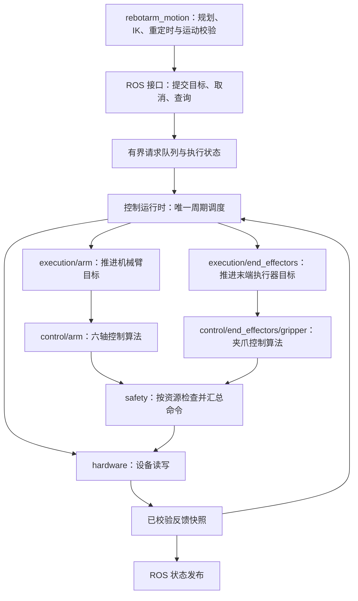

# 硬件控制器功能拆分与 C++ 迁移初步规划

> 状态：DESIGN；类型：已确认功能拆分方向、细化待评审的技术方案；适用范围：Ubuntu 24.04 / ROS 2 Jazzy 的 `rebotarmcontroller` 与其 SDK 依赖；最后核对：2026-10-25。

## 当前范围

目标是把电机驱动、周期运行时、执行保护、控制算法、执行流程和 ROS 接口分开，随后把周期控制链迁移到 C++。最底层只负责设备访问，上层通过明确接口使用它。

用户已认可按功能拆分的方向，并明确夹爪属于末端执行器，控制算法必须与六轴关节分开。模块名称、具体接口、迁移顺序和技术选型仍供评审，尚未实施代码重构。项目状态仍以 [project_status.md](../reference/project_status.md) 为准。本文发布用于评审；随同提交的既有工程修改不代表本方案已经实施，也不代表已完成实机验收。

## 前置条件与当前依据

2026-10-25 源码快照显示：

- `hardware_manager.py` 共 2968 行，`HardwareManager` 有 126 个方法，集中了设备连接、反馈缓存、生命周期、位置保持、回位、重力补偿、夹爪与线程管理。
- `ros_actions.py` 共 672 行，除 ROS Action 协议处理外，还负责轨迹时间推进、到位等待和取消；会直接修改 SDK 的 `_q_target` 等内部成员。
- `ros_services.py` 通过 SDK 执行 IK，硬件管理器通过 `ArmEndPos` 持有模型和控制状态；运动学与电机驱动尚未完全分开。
- 总线互斥通过运行时包装 SDK 方法实现，部分指令绕过 SDK 的异常处理发送；主工程已经承担较多底层维护责任。
- SDK 仍有运动层使用者 `pose_preview_solver.py`。只替换硬件包的导入，不足以删除整个 SDK 依赖。
- 当前 MotorBridge 补丁包含 C ABI 的反馈序号接口及 Rust 实现。此证据不等于已有可直接使用的完整 C++ 驱动；C ABI 覆盖范围、设备初始化及资源释放仍需验证。

依据：[当前架构](../implemented/architecture.md)、[硬件包说明](../../src/rebotarmcontroller/README.md)、[硬件执行说明](../implemented/features/hardware_execution.md)、[MotorBridge 补丁](../../patches/motorbridge/0001-add-feedback-sequence-api.patch)。行数仅作为本次设计依据，不作为重构验收指标。

工作区已有未提交的硬件及启动修改；实施前记录并确认基线，保留原有修改。反馈发布方式、严格只读接入等已有讨论见 [问题记录](../../problem/问题记录.md)，本规划不将其视为已获准实施的修复。

## 目标架构

### 先拆模块，保留一个硬件包

第一轮保留包名 `rebotarmcontroller` 和唯一硬件进程，在包内建立职责边界。各目录不对应独立 ROS 节点；是否另拆可独立复用的库，在接口稳定后决定。

| 建议模块 | 拥有的职责和状态 | 边界 |
| --- | --- | --- |
| `contracts/` | 反馈、命令、故障、执行结果的数据类型与接口 | 不依赖 ROS 消息或 SDK 对象 |
| `hardware/` | 总线连接、设备句柄、电机注册、反馈解码、模式与指令收发 | 不知道轨迹、抓取目标、回位目标和重力补偿策略 |
| `runtime/` | 唯一总线所有者、周期调度、命令仲裁、反馈快照、控制模式交接 | ROS 回调不能直接操作设备；失能时也能按既定策略采集反馈 |
| `safety/` | 反馈有效性、最终指令约束、生命周期准入、故障分类及执行保护决策 | 不负责路径规划与碰撞搜索；运动层保留自己的轨迹及运行时检查 |
| `control/arm/` | 六轴关节位置跟踪、位置保持、重力补偿及各算法内部状态 | 输入六轴反馈与机械臂目标，输出六轴命令；不管理夹爪目标和接触状态 |
| `control/end_effectors/gripper/` | 夹爪开口控制、接触判定、夹持保持、释放及其独立状态 | 输入夹爪反馈与目标，输出夹爪命令；不读写六轴算法内部状态 |
| `execution/` | 按机械臂与末端执行器分开管理目标、资源占用、取消/抢占、超时和到位；机械臂分支承担轨迹与回位执行 | 执行已校验目标，不生成笛卡尔路径或重新做 IK |
| `ros/` | Topic、Service、Action、参数、消息转换、反馈发布 | 提交请求与读取快照，不操作 SDK 私有成员，不用回调睡眠推进周期控制 |
| 节点装配入口 | 创建组件、注入依赖、启动与关闭协调 | 不积累控制算法和业务判断 |

`hardware_manager.py` 过渡期作为兼容入口转发现有调用；组件应持有各自状态，不能通过“把 manager 传给每个组件”继续共享全部内部变量。调用方迁移完后删除兼容层，或将其收敛为无控制细节的装配对象。

### 六轴机械臂与末端执行器分别控制

建议目录体现两类控制对象，以下名称均为拟议模块：

```text
control/
├── arm/
│   ├── joint_position       # 六轴关节目标跟踪
│   ├── hold                 # 六轴位置保持
│   └── gravity_compensation # 六轴重力补偿
└── end_effectors/
    └── gripper/
        ├── position         # 开口目标与电机角度映射
        ├── grasp            # 接触判定与夹持过程
        └── hold_release     # 夹持保持与释放
```

- **数据分别定义**：机械臂状态、目标与控制输出只包含六轴；夹爪拥有独立的开口、运动状态、接触判定和命令结果，不作为“第七轴”拼入六轴控制向量。设备层可以按电机标识统一编解码，控制层必须按资源类型分发。
- **参数分别维护**：六轴增益、关节限位、重力模型与夹爪开口映射、限力参数、接触阈值、保持时限分开配置。夹爪电机力矩与指端夹持力分开表达，未标定时不能把两者等同。
- **状态机分别持有**：机械臂控制模式与轨迹执行状态独立于夹爪位置/抓取/保持/释放状态。取消机械臂轨迹是否影响夹持、取消夹爪目标是否影响机械臂，应由明确的执行协调策略决定，不能靠共享一个 `_running` 或全局模式变量联动。
- **统一调度与写入**：两个控制分支均不直接访问设备；运行时分发反馈、调用各自控制算法，经统一保护检查后，按资源标识汇总命令并串行访问同一总线。独立算法不要求独立进程、串口会话或通信线程。
- **保护范围明确**：分别记录机械臂、末端执行器和总线故障；单设备故障是否影响整机，依据共享总线、持物状态和已验证保护策略决定。算法分离既不意味着故障一律互不影响，也不能将普通任务取消统一处理为整机失能。
- **保留物理耦合**：末端执行器作为负载，其质量、质心和已验证的持物负载仍影响六轴重力补偿与模型；控制算法分离不等于删除模型中的末端负载。

后续替换其他末端工具时，在 `end_effectors/` 下提供对应控制分支和设备适配，避免修改六轴控制算法；首轮只实现现有夹爪，不预先构建通用插件框架。

### 依赖和数据流



反馈检查在控制算法使用数据前完成；图中的 `safety` 还承担最终写入检查。状态快照只表示软件一致读取的一批数据，不宣称所有电机同时采样；保留每台电机自己的序号和时间戳。

### 跨包职责

- `rebotarm_motion`：保留 IK、轨迹生成、重定时、碰撞检查与运动运行时校验。当前硬件服务中的 IK/笛卡尔轨迹生成迁入该层；现有 ROS 名称和结果语义通过兼容适配保持，避免出现控制包与运动包循环依赖。
- `rebotarmcontroller`：保留轨迹执行、位置保持、重力补偿、夹爪控制及最后一道设备保护。它们拆出驱动，但仍属于本地执行链。
- `rebotarm_moveit_config`：继续提供规范 URDF、模型资源和规划配置；控制器可以读取模型资源，不反向调用运动规划实现。
- FK/动力学：优先复用 Pinocchio，在使用方保留薄适配；只有实际存在稳定共享接口时才设纯数学库，不为迁移预先增加通用包。
- `rebotarm_bringup`：负责选择 Python 或 C++ 后端，同一时间只能有一个真实总线所有者和一个对应 Action 服务端。

已接纳轨迹的时间采样属于执行；路径生成与速度规划属于运动。第一轮保持当前轨迹执行语义，改进插值算法需另列行为变更并验证。

## 核心接口草案

以下类型为语义草案，不是已存在的 API；Python 拆分和 C++ 实现应遵循同一份契约。

| 接口/类型 | 关键内容 |
| --- | --- |
| `MotorState` / `FeedbackSnapshot` | 设备标识、位置/速度/力矩、状态码、每电机序号、单调时钟接收时间、有效性；关节单位为 rad，夹爪开口的 m 映射在上层完成 |
| `MotorCommand` / `CommandBatch` | 目标资源、模式、位置/速度/力矩或 MIT 参数、命令编号、所属任务/模式代次、有效期、应用结果 |
| `MotorDriver` | 连接、采集、写入、模式与使能操作、关闭；单个失败必须返回明确结果，不吞异常、不暗中回位 |
| `ArmState` / `ArmTarget` / `ArmCommand` | 六轴反馈、目标和输出；不包含夹爪开口、接触状态与夹爪电机参数 |
| `GripperState` / `GripperTarget` / `GripperCommand` | 独立的开口、反馈时效、接触判定与目标语义；区分开口控制、抓取、保持和释放，单位及电机映射由夹爪分支定义 |
| `ArmControlLaw.update` / `GripperControlLaw.update` | 使用各自强类型的状态与目标，返回各自控制输出及诊断；不自行通信、发布 ROS 消息或启动线程 |
| `ArmExecution` / `EndEffectorExecution` | 各自提供 `submit/cancel/status`，管理本资源的目标准入、进度和终态；协同动作通过明确协调接口组合 |
| `SafetyDecision` | 允许、拒绝、受控停止保持、保护性失能及原因；禁止用一个通用异常处理覆盖全部情况 |

需要在第一轮明确的约束：

1. **状态归属**：设备生命周期归运行时；机械臂与末端任务状态分别归各自执行器；六轴积分状态归机械臂算法，夹爪接触与保持状态归夹爪算法；ROS goal 只映射对应资源的执行结果。
2. **资源与优先级**：机械臂轨迹和机械臂透传互斥，夹爪位置/抓取/透传也在夹爪资源内互斥；两类资源是否并行按声明协调，不能把所有目标粗暴合成全局单目标，也不能产生第二个总线线程。
3. **取消与抢占**：新目标或模式交接后，旧代次命令必须被拒绝；取消终态与实际停止/保持的确认条件写清楚，防止旧回调再次写入。
4. **时钟与缓存**：控制时序和超时使用单调时钟，ROS 时间只作消息表达；重复发布缓存不能被当作新反馈。
5. **部分发送失败**：多电机批次不是总线事务意义上的原子操作，需记录哪些指令已经发送，并进入对应保护分支，不能简单重试整批或返回成功。
6. **最终保护在本地**：上层进程退出、请求队列堵塞或目标过期时，本地运行时仍能按已定义策略处理。健康设备的可恢复任务失败不得直接失能。

`read → validate → update target → compute → guard → write` 表示逻辑顺序。实际反馈刷新应遵守独立频率和通信预算，不要求每个控制周期都进行完整阻塞轮询。

## C++ 迁移路线

### 初步推荐

目标为不依赖 Python 的 C++ 周期控制核心与薄 ROS 适配层。初期保留现有 ROS 对外接口，规划、视觉、示教和 Dashboard 通过原有协议访问控制器。迁移验证时可将新旧算法离线运行在同一组反馈上比较；不同时启动两个真实硬件后端。

优先验证 C++ 经 MotorBridge C ABI 使用现有通信实现，保留已有反馈序号和传输修补。原始协议暂不重写。若 ABI 缺少必要能力，单独评估扩展适配层和新增维护成本，不能退回在 C++ 周期里嵌入 Python 调用并声称已完成迁移。

C++ 接入验证需覆盖：动态库与头文件构建/部署、ABI 能力识别、每电机反馈序号、初始化握手、超时、错误码、模式切换、置零前置条件、句柄释放和重连后状态失效。当前本机完整 MotorBridge 构建源码目录不存在；首轮只验证这些能力，不假定已具备。

构建上先保留 ROS 包名，后续调整为能构建 C++ 核心和 ROS 节点的工程；过渡期 Python 兼容入口如何安装应在离线样例中验证。依赖版本继续由现有依赖文档和安装工具维护，许可证及来源保留。

是否采用 `ros2_control` 作为最终承载框架，列为 C++ 接入验证后的独立选型项。比较标准是现有 MIT/位置模式、共享总线、反馈序号、保护语义、取消/保持和 MoveIt 接口的承载成本。初步拆分不绑定框架，不同时开展两套完整驱动实现。

### 周期与线程

- 运行时独占设备操作；ROS 线程经有界队列提交请求，读取不可变快照。
- 反馈采集、控制计算、状态发布各自有明确频率；发布频率不代表新反馈频率。
- 核心周期避免不受控的分配、阻塞日志和模型加载；诊断通过快照在周期外输出。
- 记录周期平均值、P95/P99、最大值、超期次数、反馈年龄与连续超期行为。频率和允许预算由基线测量与设备能力确定，初稿不承诺 1 kHz 或硬实时。

## 建议实施顺序与每轮验收

| 顺序 | 工作与交付物 | 完成条件 |
| --- | --- | --- |
| 1. 固定接口与基线 | 整理公共 ROS 接口、默认配置、SDK 调用、状态迁移和已知问题；定义核心数据与设备接口；做 MotorBridge C++ 离线接入验证 | 设备接口及错误语义可评审；现有专项测试可复现；C++ 不经 Python 可访问所需 ABI，或明确记录缺口 |
| 2. 抽出设备与反馈 | `hardware/` 封装 SDK；提取反馈批次缓存、时效校验和生命周期判断；配置迁入硬件包并保持显式路径覆盖 | 旧入口仍可用；只有驱动接触 SDK；不会因发布回调而形成第二套设备访问；默认值与已有安全行为有对照 |
| 3. 拆控制与执行 | 分别建立六轴与末端执行器控制分支、参数和执行状态；轨迹推进从 ROS Action 抽出；由运行时协调取消、仲裁与周期调度；将 IK/路径生成归回运动层 | ROS 层不再修改 `_q_target` 等内部对象；六轴与夹爪状态互不串用；独立/协同执行、取消/故障/模式交接通过回放与故障注入；MoveIt Execute 链路软件验收通过 |
| 4. 替换 C++ 核心 | 在确定的承载框架中实现驱动适配、运行时、控制算法和执行器；保留 ROS 契约；逐步消除 Python SDK 依赖 | 新旧离线输入输出差异可解释；并发及资源释放检查通过；伪终端协议测试和安装区运行通过；周期指标有实测数据 |
| 5. 集成验收与收尾 | 另行授权后分项实机验收；确认回退方式；清理兼容入口与无引用 SDK 部分，更新架构、部署和状态文档 | 软件/仿真与实机结论分别记录；启动、取消、保持、模式切换和故障行为按约定验收；全仓无残余依赖后才移除 SDK |

建议第一轮实施只做到第 1 项与第 2 项的基础接口，不同时改重力补偿参数、夹爪控制策略、标定和运动算法。每轮可以独立评审和回退。回退通过停止当前后端、确认设备状态后切换版本；不在运行中的总线上热切换驱动。

## 验证方案

复用现有测试，补充能够暴露行为差异的契约测试；不为“文件被搬到新目录”编写大量形式测试。

| 验证对象 | 重点场景 | 现有起点 |
| --- | --- | --- |
| 设备与反馈 | 错帧、重复帧、超时、掉线、序号不前进、部分发送失败、资源释放 | `test_motorbridge_transport_safety.py`、`test_controller_feedback_cache.py` |
| 生命周期与保护 | 默认失能、使能前反馈、控制故障、健康任务失败保持、取消后旧命令失效 | `test_hardware_manager_p0_safety.py`，增加并发事件及虚拟时钟用例 |
| 重力补偿 | 输入一致性、积分限幅、力矩/变化率约束、模式交接和故障保持 | `test_gravity_compensation_core.py`、`test_gravity_control_safety.py` |
| 夹爪 | 开口映射、到位/卡滞、接触保持、释放、超时与取消、和机械臂共享总线 | `test_gripper_action_completion.py`、`test_gripper_safety_configuration.py` |
| 六轴与末端边界 | 六轴目标拒绝夹爪数据；两类控制状态/参数独立；机械臂保持时夹爪可按许可动作；协同取消与跨资源故障按显式策略处理；总线仅有一个写入者 | 在现有机械臂与夹爪测试上增加资源隔离、协调策略和调度用例 |
| ROS 与运动 | Action 接纳/反馈/终态、抢占、保持确认、MoveIt 实际 Execute、旧客户端兼容 | 分层测试及隔离域的假硬件集成测试 |
| C++ 对照 | 相同记录输入的输出、状态迁移和故障决策；线程竞争、句柄生命周期和周期时间 | 在前两轮形成统一数据集及预期结果 |

MuJoCo 用于物理响应与流程验证；伪终端/假设备用于协议与故障验证。MuJoCo 成功不能证明真实串口、设备模式或硬件安全已通过验收。测试数据以冻结基线及明确修正后的期望为准，不盲目复制已知错误行为。

实现期间在仓库根目录执行 `AGENTS.md` 规定的分层、全量 pytest 与编译检查，并补充新硬件包的 Python 编译检查、C++ 构建/测试和安装区验证。ROS 集成测试选空闲隔离域，只停止本轮进程。

## 边界、待定项与评审重点

- **最底层范围**：推荐最底层只保留设备访问，算法和执行在同包独立模块；本轮不增加多个设备节点。
- **现有缺陷**：反馈采集/发布与严格只读接入已有独立问题记录。重构可为其提供接口，但采样策略、连接副作用等行为调整需单独明确，不能以移动代码代替验收。
- **关闭与回位**：必须区分预设停靠位与本轮验证的恢复基线；健康回位失败不能落入无条件失能的清理分支。既有冲突应单独记录、确定预期并测试。
- **SDK 退役条件**：当前 `AGENTS.md` 仍约定保留 SDK。初步规划不删除它；用户选定方案且全仓调用完成迁移后，同步更新该约定、依赖清单和部署说明。
- **模型与参数**：沿用规范模型；新夹爪及 D405 的实物标定和载荷验收另行进行，重构不顺带调整开口、零位、限位和重力补偿参数。
- **时间估算**：第 1 项完成后，依据 ABI 缺口、公共接口数量和测试覆盖给出工期；当前不以行数推算工期。

已确认按功能拆分，并在控制算法内区分六轴机械臂与末端执行器。后续评审重点是具体接口、两类资源的协同与故障传播策略，以及“先 Python 解耦、再 C++ 替换周期核心”的实施顺序。

## 验证结果与相关文档

本文完成源码与现有文档核对、设计编写及文档链接检查，未进行重构、C++ 接入实验或实机验收。按仓库规范执行的现有工作区回归及发现的夹爪限位基线问题，统一记录在 [项目状态](../reference/project_status.md#当前限制与待解决问题)，不作为重构验收结果。

- [架构与包边界](../implemented/architecture.md)
- [硬件执行与重力补偿](../implemented/features/hardware_execution.md)
- [ROS SDK 接口](../reference/ros_sdk.md)
- [依赖与第三方归属](../reference/third_party_notices.md)
- [项目状态](../reference/project_status.md)
