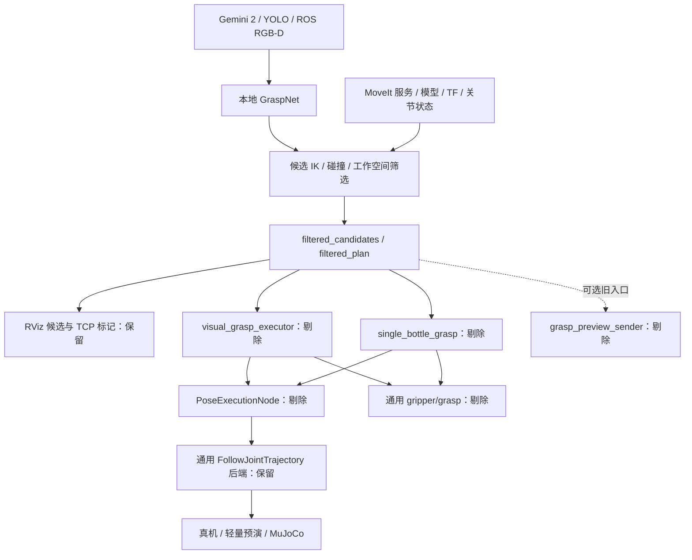

# 视觉抓取执行链路剔除范围

> 状态：历史范围清单；类型：结构剔除实施前核查；源码核对：2026-11-05。当前实现及验证以[项目状态](../reference/project_status.md)和[视觉候选说明](../implemented/features/visual_grasp.md)为准。

现行总入口为 `visual_perception_system.launch.py`，筛选结果显示片段为 `includes/candidate_markers.launch.py`；下文保留实施前的文件名称与结构。

## 当前范围

视觉链路收敛到 Gemini 2 → YOLO → ROS RGB-D/CameraInfo/检测结果 → 本地 GraspNet → 候选筛选 → 结果与标记发布。
剔除筛选结果驱动的真机、轻量仿真和 MuJoCo 执行，以及开爪、接近、夹取、握持、校验、撤退、放置、重试等任务编排。
用户已明确将控制器通用 `/rebotarm/gripper/grasp` 接口及力闭合、握持状态机纳入范围。

保留独立夹爪位置开合、网页/键盘遥操作、示教、通用 MoveIt 和 MuJoCo 功能。下文给出实施清单；工程进展和实际验证结果统一记录在[项目状态](../reference/project_status.md)。

## 当前结构与剔除位置



- 总入口 `src/rebotarm_bringup/launch/visual_grasp_system.launch.py` 强制启动候选筛选、运动执行和视觉执行器。`execute_gripper=false` 只控制夹爪步骤，机械臂执行服务仍会启动。
- `includes/visual_lifecycle.launch.py` 依次组合视觉输入、候选生成、筛选、运动执行、抓取执行和预览。
- `includes/visual_backend.launch.py` 在 `use_hardware=false` 时启动 `rebotarm_preview` 的轻量轨迹控制器，并复用 `interactive_system.launch.py`。该默认组合使用关节插值预演。
- MuJoCo 由独立的 `mujoco_moveit_sim.launch.py` 启动，通过通用 FollowJointTrajectory、SetGripper 和 GripperCommand 接口承接运动。视觉侧共用运动服务；源码中没有独立的“视觉 MuJoCo 执行器”。
- `single_bottle_grasp.py` 是独立安装的命令，直接消费 `filtered_plan`，调用使能、位姿执行、力夹取、释放和回基线流程，须同步剔除。
- `grasp_preview_sender_node.py` 将 GraspPlan 转成 Pose 并转发到 `interactive_control/pose_target`；仓内未发现该默认话题的当前订阅方，属于遗留转发入口。纯 Marker 节点继续保留。

### 筛选端必须保留的依赖

筛选包括置信度/开度检查、传感器时间戳 TF、完整候选姿态及平行夹爪对称变体、TCP/预抓取几何、工作空间/高度门控、IK、碰撞检查和关节行程排序。

`candidate_ik_gateway.py` 使用 `/compute_ik`、`/check_state_validity` 和有效关节状态种子；默认种子话题为 `/rebotarm/visual_joint_states`。缺少种子时跳过 IK。
因此，剔除执行启动后，仍须明确提供模型、TF、MoveIt 查询服务和关节状态来源。仿真观察模式可用被动状态源；真机观察模式复用现有反馈。具体装配应在原启动文件内收敛，避免为筛选隐式启动运动执行器。

## 整文件删除清单

以下路径均相对仓库根目录。删除时同步清理入口注册、配置加载和测试引用。

### 视觉执行实现

共同前缀：`src/rebotarm_vision/rebotarm_vision/`。

```text
nodes/visual_grasp_executor_node.py
nodes/grasp_preview_sender_node.py
visual_grasp_config.py
visual_grasp_io.py
visual_grasp_runtime.py
visual_grasp_service_gateway.py
visual_grasp_state.py
visual_grasp_workflow.py
grasp_input_receiver.py
gripper_quality.py
single_bottle_grasp.py
utils/visual_grasp_messages.py
policies/gripper_policy.py
policies/grasp_retry_policy.py
policies/grasp_verification_policy.py
policies/place_task_policy.py
policies/retreat_policy.py
policies/trajectory_recovery_policy.py
policies/visual_grasp_runtime_policy.py
policies/visual_servo_policy.py
```

这些模块分别承担执行适配、输入缓存、执行状态、服务调用、夹取质量判定和任务策略。源码导入核查中，它们的视觉生产消费者均在待剔除执行分支内；共享 `PoseTarget` 的处理见下一节。

### 运动、服务和启动片段

| 文件 | 删除依据 |
| --- | --- |
| `src/rebotarm_motion/rebotarm_motion/pose_execution_node.py` | 仓内运行调用方为视觉执行器和单瓶流程；两条调用链同时剔除 |
| `src/rebotarm_motion/rebotarm_motion/gripper_preview.py` | 仅由 PoseExecutionNode 拼接视觉轨迹预览使用 |
| `src/rebotarm_msgs/srv/ExecutePose.srv` | 随上述服务端与客户端删除 |
| `src/rebotarm_msgs/srv/PublishTrajectoryPreview.srv` | 随视觉批次预览服务删除 |
| `src/rebotarm_msgs/srv/GraspGripper.srv` | 用户确认剔除通用力夹取接口 |
| `src/rebotarm_bringup/launch/includes/motion_execution.launch.py` | 只装配 PoseExecutionNode |
| `src/rebotarm_bringup/launch/includes/grasp_executor.launch.py` | 只装配视觉执行器及其执行参数 |

### 专用配置与操作页

```text
src/rebotarm_bringup/config/visual_backend_profile.yaml
src/rebotarm_motion/config/visual_motion_profile.yaml
src/rebotarm_vision/config/gripper_policy.yaml
src/rebotarm_vision/config/retry_policy.yaml
src/rebotarm_vision/config/retreat_policy.yaml
src/rebotarm_vision/config/visual_servo.yaml
src/rebotarm_vision/config/single_bottle_grasp.yaml
docs/single_bottle_grasp_zh.md
```

前两个 profile 目前分别提供视觉组合的硬件执行参数、仿真初态及运动速度。移除视觉执行装配后清理这两个加载入口；通用硬件/仿真入口继续维护自己的配置。

## 先迁移共享定义，再删除

`src/rebotarm_vision/rebotarm_vision/visual_grasp_sequence.py` 混合了共享位姿值类型 `PoseTarget` 和执行序列构造。

五个保留模块直接导入该类型：

```text
nodes/candidate_ik_filter_node.py
policies/candidate_ik_policy.py
policies/candidate_target_policy.py
policies/motion_feasibility_policy.py
policies/visual_grasp_pose_policy.py
```

实施时先将 `PoseTarget` 移入视觉包内独立的候选位姿值模块，更新上述五处导入及保留测试，再整文件删除序列模块。
`VisualGraspStage`、`VisualGraspSequenceConfig`、`resolve_gripper_widths()`、`build_visual_grasp_sequence()` 随执行分支剔除。
只搬动共享值定义，保留现有几何算法与筛选结果语义。

## 保留文件，局部清理

### 视觉装配与共享策略

| 文件 | 清理内容与保留内容 |
| --- | --- |
| `src/rebotarm_bringup/launch/visual_grasp_system.launch.py` | 移除强制执行开关、执行参数和两个执行 profile；入口收敛到候选筛选及显示 |
| `src/rebotarm_bringup/launch/includes/visual_lifecycle.launch.py` | 移除 motion_execution、grasp_executor 两个阶段；保留输入、候选、筛选和显示 |
| `src/rebotarm_bringup/launch/includes/visual_backend.launch.py` | 保留筛选需要的模型、状态、TF、MoveIt 服务装配；移除视觉执行后端启动连接 |
| `src/rebotarm_bringup/launch/includes/grasp_preview.launch.py` | 删除 preview sender 节点；保留 visual_grasp_markers |
| `src/rebotarm_bringup/config/visual_grasp_interfaces.yaml` | 删除 executor、motion_execution、preview sender 参数组和执行连线；保留筛选输出及标记输入。`executor_input_topic` 当前也供 Marker 使用，需同步改为显示输入名称 |
| `src/rebotarm_vision/config/visual_strategy_profile.yaml` | 保留相机/GraspNet/候选几何、门控和显示参数；删除执行、闭合、保持、撤退、放置、重试和伺服参数 |
| `src/rebotarm_vision/config/grasp_pose_policy.yaml` | 保留候选和 Marker 参数组；删除 executor 和 sender 参数组 |
| `src/rebotarm_vision/config/table_safety.yaml` | 删除 executor 参数组；候选高度和工作空间参数归候选配置。该文件当前仅由 executor 启动片段加载，实施时先确认保留筛选参数的实际加载来源，再消除重复配置 |
| `src/rebotarm_vision/rebotarm_vision/policies/visual_grasp_pose_policy.py` | 保留 `build_preserve_candidate_grasp_targets()` 及其官方几何、TCP、接近点计算依赖；仅执行流程使用的几何分支可在调用核查后清理 |
| `src/rebotarm_vision/rebotarm_vision/policies/candidate_target_policy.py` | 更新 PoseTarget 导入；随几何分支清理无调用导入，保留 preserve_candidate_pose 路线 |

### 控制器通用力夹取与握持

共同前缀：`src/rebotarmcontroller/rebotarmcontroller/`。下列文件全部保留。

| 文件 | 剔除内容 |
| --- | --- |
| `ros/ros_services.py` | GraspGripper 导入、`gripper/grasp` 服务注册和 `grasp_gripper()` 回调 |
| `contracts/ros_ports.py` | `GripperRosPort.grasp_gripper()` 声明 |
| `gripper/gripper_controller.py` | `submit_grasp()`、`grasp_gripper()`、握持超时/释放/原因查询，以及 bind、停止时的专用字段复位 |
| `gripper/gripper_execution.py` | 力夹取请求及等待结果、start/expire_grasp、接触/堵转推断、`grasp_closing`/`grasp_holding` 分支、握持期限和释放；同步清理 supersede、失败和发送完成路径中的夹取请求处理 |
| `gripper/gripper_control.py` | `_G_GRASP_*` 专用常量 |
| `runtime/device_requests.py` | submit_grasp、release_grasp_hold 两条请求策略 |
| `configuration.py` | `grasp_hold_timeout_sec` 设置及校验 |
| `controller_parameters.py` | 力夹取/握持常量导入与转出 |
| `hardware_manager.py` | 握持超时构造参数和 GripperSettings 装配参数 |
| `rebotarm_controller.py` | 握持超时 ROS 参数声明、读取和传递 |

同一参数还经过以下共享启动文件，局部删除 `grasp_hold_timeout_sec` 的声明和传递：

```text
src/rebotarm_bringup/launch/hardware_controller.launch.py
src/rebotarm_bringup/launch/interactive_system.launch.py
src/rebotarm_bringup/launch/moveit_hardware.launch.py
src/rebotarm_bringup/launch/teleop_keyboard.launch.py
```

继续保留夹爪位置目标、宽度/角度映射、零点、限速限矩、反馈新鲜度、代次归属、资源预约、取消、到位后的中性释放及错误处理。
`_G_TAU_MAX` 等通用力矩上限仍服务位置控制和透传。六轴轨迹的末端目标保持、取消保持和重力补偿继续保留。
`runtime/lifecycle.py` 和 `contracts/component_ports.py` 当前未发现上述力夹取专用符号，暂按原有职责保留。

### 构建与包依赖

- `src/rebotarm_vision/setup.py`：注销 executor、single_bottle、preview sender 三个命令，清理删除配置的安装项。
- `src/rebotarm_vision/package.xml`：去掉仅由单瓶流程使用的 rebotarm_motion 依赖；保留候选 IK/碰撞依赖的 moveit_msgs。
- `src/rebotarm_motion/setup.py`、`src/rebotarm_motion/CMakeLists.txt`：两处同时移除 PoseExecutionNode 注册。若删除 visual_motion_profile 后 config 目录为空，同步清理该安装声明。
- `src/rebotarm_msgs/CMakeLists.txt`：移除三个已删除服务定义的生成注册。
- `src/rebotarm_bringup/setup.py`：核查 launch/config 资源收集；通配收集随源文件消失，显式安装项同步删除。

## 重点保留清单

| 范围 | 保留文件或目录 | 原因 |
| --- | --- | --- |
| 相机与检测 | vision 包的 `camera/`、`detector/`、`converters/`、`nodes/vision_node.py`、离线 YOLO 工具 | 当前 Ubuntu ROS 视觉输入 |
| GraspNet | `nodes/graspnet_baseline_node.py`、`graspnet_baseline_adapter.py`、`backends/`、模型与第三方依赖安装工具 | 候选生成 |
| 候选筛选 | `nodes/candidate_ik_filter_node.py`、`candidate_ik_config.py`、`candidate_ik_gateway.py`、`candidate_ik_runtime.py`、`candidate_tf_adapter.py` | 筛选主链路 |
| 候选策略 | `policies/candidate_*`、`motion_feasibility_policy.py`、`pose_variant_policy.py`、`approach_policy.py` | 工作空间、IK、评分、对称姿态和接近点几何 |
| 显示与坐标 | `nodes/grasp_candidate_marker_node.py`、`nodes/visual_grasp_marker_node.py`、`nodes/grasp_tcp_frame_node.py`、`utils/tf_message_adapter.py` | 原始/筛选候选显示与共享 TF 计算 |
| 标定与诊断 | `handeye_config.py`、`config/handeye.yaml`、相机/GraspNet 配置、`diagnostics/` | 手眼外参、深度和点云核查 |
| 视觉启动 | `vision.launch.py`、`vision_ubuntu.launch.py`、bringup 的 visual_input、grasp_candidate、candidate_filter 片段及 `visual_profiles.py` | 剔除后仍有活动消费者 |
| 视觉消息 | Detection2D、Detection2DArray、GraspCandidate、GraspCandidateArray、**GraspPlan** | GraspPlan 继续由筛选端发布、Marker 消费 |
| 通用运动 | `moveit_planner.py`、`pose_compat_node.py`、`feedback_receiver.py`、`stop_feedback.py`、受控轨迹/恢复/准备/重定时模块及 `rebotarm_trajectory` | 示教、遥操作和通用运动继续使用；moveit_planner 被 teach_replay_workflow 直接调用 |
| 通用控制接口 | SetGripper、GripperCommand、MoveToPoseIK、MoveToPose/MoveRelative、ExecuteTeleopMotion、FJT 及 prepared 相关接口 | 独立位置控制与现有操作流程 |
| 夹爪资源 | 控制器和 bringup 的 `config/gripper.yaml`、控制器 `examples/gripper_control.py` | 电机配置和 SetGripper 位置示例 |
| 轻量预演 | `rebotarm_preview` 包 | RViz、遥操作等通用消费者继续使用 |
| MuJoCo | `mujoco_moveit_sim.launch.py`、simulation 包的 `ros/mujoco_ros_node.py`、`execution/`、`control/sim_gripper.py`、物理内核与模型 | 现有独立位置开合、示教、通用轨迹和仿真 |
| 机器人资源 | URDF、SRDF、碰撞模型、夹爪/软指 mesh、TCP 定义、MoveIt 配置 | 候选几何、碰撞检查和显示仍依赖 |

MuJoCo 的 `execution/gripper_execution.py` 当前推进位置任务及中性释放，ROS 节点提供 SetGripper/GripperCommand，源码没有 GraspGripper 服务。该位置执行组件完整保留。

### 另行标出的独立功能和闲置接口

- simulation 包的 `core/pick_task.py`、`core/mujoco_pick_env.py`、`diagnostics/mujoco_pick_batch.py`、`diagnostics/mujoco_grasp_quality.py`、`diagnostics/mujoco_runner.py` 属于独立 Pick/Gym 或显式物理试验，未接收筛选候选。本轮按独立仿真功能保留，避免连带删除其入口、评估与测试。
- `ExecuteGrasp.action`、`PlanGraspForLabel.srv`、`TaskStatus.msg`、`ExecutionState.msg` 在仓内仅发现生成注册，未发现活动服务端/客户端或发布/订阅。将其列为独立公共接口清理项，本轮主链剔除先保留；仓外消费者尚未核查。motion 的 `command_models.ExecutionState` 是另一个活动 Python 枚举，继续保留。

## 测试与验证工具的处理

### 随功能删除

```text
tests/test_single_bottle_grasp_candidate.py
tests/test_single_bottle_grasp_feature.py
tests/test_single_bottle_grasp_profile.py
tests/test_single_bottle_plan_stability.py
tests/test_visual_stop_confirmation_runtime.py
tests/test_visual_ready_removal.py
```

### 先迁移共享断言，再清理旧文件

| 文件 | 处理方式 |
| --- | --- |
| `tests/test_visual_plan_only_preview.py` | MoveIt 显式起点请求验证归 `test_moveit_explicit_start.py`；其余随视觉执行/预览删除 |
| `tests/test_grasp_preview_sender.py` | TF 变换和 TCP 偏移验证归 `test_tf_message_adapter.py`；删除 sender 测试与旧文件 |
| `tests/test_visual_grasp_sequence.py` | 共享几何覆盖归 `test_visual_grasp_pose_policy.py`，PoseTarget 契约归 `test_candidate_target_policy.py`；删除阶段序列、夹取、伺服、放置及执行器消费计划测试 |
| `tests/test_vision_execution_lifecycle.py` | 候选配置校验归 `test_candidate_ik_runtime.py`，按传感器时间查询 TF 及帧内缓存验证归 `test_candidate_tf_adapter.py`；执行状态/网关/生命周期测试随执行器清理 |

### 保留并局部调整

- `tests/test_gripper_execution.py`、`tests/test_hardware_manager_p0_safety.py`：删除力闭合、堵转推断、握持和超时释放测试；保留位置执行、反馈、发送失败、中性释放及安全用例。
- `tests/test_p005_prepared_controller.py`：清理 release_grasp_hold 相关调用，保留轨迹上下文失效、资源预约、组合取消和部分写入失败覆盖；公共保护路径的测试改从保留入口触发。
- `tests/test_motion_stop_confirmation.py`：删除 PoseExecutionNode 专用部分，保留 StopFeedback 共享验证。
- `tests/test_vision_input_policy.py`：保留相机内参、按名称读取关节和相机故障处理；候选配置/运行时集中到 `tests/test_candidate_ik_runtime.py`，原 `test_vision_runtime_layers.py` 撤出。
- `tests/test_visual_grasp_launch_contract.py`：集中检查“输入→候选→筛选→显示”、offline/external 组合及旧参数拒绝；原 `test_visual_compact_contract.py`、`test_visual_grasp_launch_cleanup.py` 合并后删除。消息注册与退役服务检查归 `test_package_resources.py`，原生视觉进程配置归 `test_p3_ubuntu_native_profile.py`。
- `tests/test_graspnet_baseline_adapter.py`：保留本地推理、点云和候选转换；TF 故障与候选门控用例分别归 `test_candidate_ik_runtime.py`、`test_candidate_gate_policy.py`。迁移临时文件 `test_candidate_shared_geometry.py` 的有效覆盖归入上述现有文件，重复几何验证删除。
- `tests/test_rebotarm_app_launch.py`：移除握持超时传递断言，保留遥操作启动及通用仿真合同。
- `tests/conftest.py`：删除被移除服务的测试桩；保留使用中的消息类型。
- `tests/fixtures/feedback_consumers_probe.py`：移除视觉执行器和 PoseExecutionNode 探针；保留 PoseCompat 等消费者验证。
- `scripts/validate_p005_simulation.py`：删除视觉 precontact 专项及其序列/网关/服务导入；保留其他 MoveIt、遥操作、示教和物理验收部分。

候选筛选、候选姿态、Marker、GraspNet、相机、手眼 TF、位置夹爪、通用轨迹、MuJoCo 和遥操作测试继续保留。

## 文档联动与实施顺序

实施时删除专用单瓶操作页，更新以下现有页面中的执行入口、接口和拓扑描述：

- `docs/implemented/features/visual_grasp.md`、`docs/reference/commands/visual_grasp_commands.md`；
- `docs/implemented/architecture.md`、`docs/reference/topology/system_dataflow.md`、`docs/reference/ros_sdk.md`；
- `docs/implemented/features/hardware_execution.md`、`docs/implemented/features/p005_prepared_trajectory.md`、`docs/implemented/features/feedback_consumer_scheduling.md` 中受影响的接口/适用范围；
- `docs/implemented/features/system_capabilities.md`、`docs/implemented/README.md`、`docs/setup/ubuntu_vision_setup_zh.md`、`docs/setup/launch_python_configuration.md`；
- `docs/reference/parameters/current_parameter_sources.md`、`docs/reference/commands/README.md`、`system_runtime.md`、`rebotarm_common_commands.md` 和 `ubuntu_vision_readonly_test_zh.md` 中的受影响引用；
- bringup、vision、motion、msgs、controller 的 README，以及 bringup 的 `launch/README.md`；
- 总索引与唯一项目状态文档。

用户维护页保持原有归属；既有验收证据保留当时范围，当前操作说明随实现调整。

建议实施顺序：

1. 迁移共享 PoseTarget 和测试断言，明确筛选的模型/TF/状态服务装配。
2. 一次移除视觉 executor、single_bottle、旧 sender、专用运动服务与配置，更新启动和构建注册。
3. 剔除控制器 GraspGripper 及力夹取/握持分支，同时清理端口、参数、请求策略和测试。
4. 更新现有功能/命令/拓扑文档，清理安装产物中遗留的旧入口。
5. 检查导入、注册与引用，执行规定分层及编译检查；本次实施跨视觉、运动、消息、控制器且触及夹爪执行状态，需完整软件回归和隔离安装/仿真验收。真机动作另按现场授权执行。

软件验收重点：筛选和 Marker 能独立运行；视觉侧移除执行服务调用；GraspGripper 与力握持模式撤出；独立位置夹爪、网页/示教、取消及中性释放保持可用；通用 MuJoCo 链路可正常执行。
